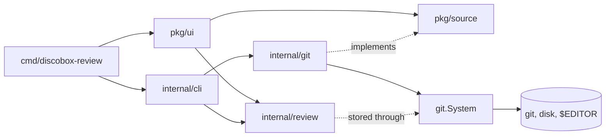

# discobox-review design

discobox-review is a terminal code review: a window that reads a change from a
source, and a review file that records what has been approved and said about
it. `README.md` is the full account of behavior; this is how the pieces fit.

## Packages

- `pkg/source` is everything the window needs of a change: one required
  interface, `Source` (the diff, its commits, a file's text at a commit), and
  three a source may add — `Store` (somewhere to keep the review), `Worktree`
  (branches, checkout, `$EDITOR`) and `Carrier` (carrying a comment between a
  commit and the whole review). The window asks once, when it is made, and
  offers only what the source has.
- `pkg/ui` is the window, a Bubble Tea model. `cmd/discobox-review` runs it
  over a Git working tree; another program embeds it over its own source (the
  discobox console's pull request page). It draws every control character a
  source hands it as its Unicode symbol: nothing a source says reaches the
  terminal as an instruction.
- `internal/git` is `*git.Repo`, the source the command uses, and it is all
  four interfaces. Every command it runs and every file it touches goes
  through `git.System`; `Local` is the real one. A test fails if anything
  outside `system.go` runs a command or touches a file.
- `internal/review` is the review document — approvals by reviewer and by
  hunk, digests, threads — and the store that reads and writes it under a
  lock. It does no I/O of its own; the caller's `System` does.
- `internal/cli` is the subcommands: the same review, driven without the
  window, for scripts and agents.

## The review file

The review is `.git/discobox-review.json`, one file per branch: checking out
another branch moves it to `.git/discobox-review.<branch>.json` and moves that
branch's into place. The file is the interface for agents, so its format is
kept flat and readable; `internal/review` owns it.

## Reading and drawing

A rescan is a fixed dozen or so git commands whatever the size of the change,
and parsing and lexing happen off the render path. The window polls its review
file once a second and never its source; a host whose source has moved sends
`ui.RescanMsg`.
