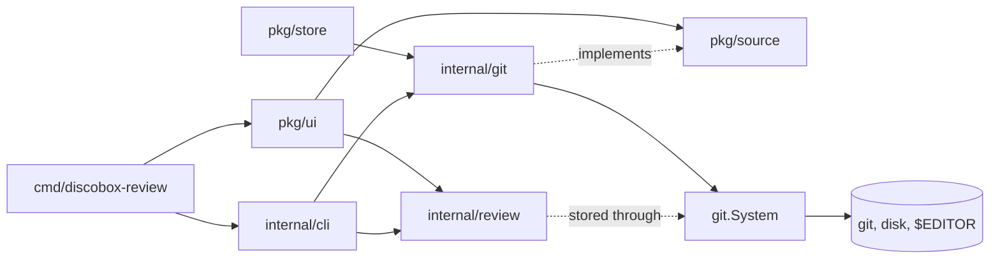

# discobox-review design

discobox-review is a terminal code review: a window that reads a change from a
source, and a review file that records what has been approved and said about
it. `README.md` is the full account of behavior; this is how the pieces fit.

## Packages

- `pkg/source` is everything the window needs of a change: one required
  interface, `Source` (the diff, its commits, a file's text at a commit), and
  two a source may add — `Worktree` (branches, checkout, `$EDITOR`) and
  `Carrier` (carrying a comment between a commit and the whole review). The
  window asks once, when it is made, and offers only what the source has.
  `Store`, somewhere to keep the review, is handed to the window beside the
  source (`ui.Options.Store`), since a change read from GitHub is reviewed on
  local disk; with none the window only reads.
- `pkg/store` is a `Store` in a directory of its own, for a host whose source
  has no git directory: the discobox console keeps a pull request's review in
  one. It is `internal/git`'s state files, over `git.Local`.
- `pkg/ui` is the window, a Bubble Tea model. `cmd/discobox-review` runs it
  over a Git working tree; another program embeds it over its own source (the
  discobox console's pull request page). It draws every control character a
  source hands it as its Unicode symbol: nothing a source says reaches the
  terminal as an instruction.
- `internal/git` is `*git.Repo`, the source the command uses: all three
  interfaces, and a `Store` too, in its git directory (`git.StateDir`, which
  `pkg/store` reuses). `*git.Snapshot` (`-head`) is the same repository up to
  one commit instead of the working tree: a `Source` and a `Carrier`, never a
  `Worktree`, reviewed in the repository's own store. Every command it runs and every file it touches goes
  through `git.System`; `Local` is the real one. A test fails if anything
  outside `system.go` runs a command or touches a file.
- `internal/review` is the review document — approvals by reviewer and by
  hunk, digests, threads, the review card — and the store that reads and
  writes it under a lock. It does no I/O of its own; the caller's `System`
  does. The card's format is `card.schema.json`, embedded, which `ParseCard`
  holds a card to.
- `internal/cli` is the subcommands: the same review, driven without the
  window, for scripts and agents.

## The review file

The review is `discobox-review.json` in whatever store the window is given:
the git directory for the command, a directory of its own for a pull request
(`pkg/store`). It is one file per branch: a scan naming another branch moves
it to `discobox-review.<branch>.json` beside it and moves that branch's into
place. The file is the interface for agents, so its format is kept flat and
readable; `internal/review` owns it. The commands read only the git
directory's.

## Reading and drawing

With a review card the stack is two groups, the core and the rest
(`pkg/ui/card.go`). A file in both is two entries: the core's is a copy of
the file's own, made on every rebuild with lines and gaps of its own and
keyed apart (`reviewFile.id`), so the stack finds, folds and keeps the cursor
in each entry by its id and acts on the review by its path.

A rescan is a fixed dozen or so git commands whatever the size of the change,
and parsing and lexing happen off the render path. The window polls its review
file once a second and never its source; a host whose source has moved sends
`ui.RescanMsg`.
