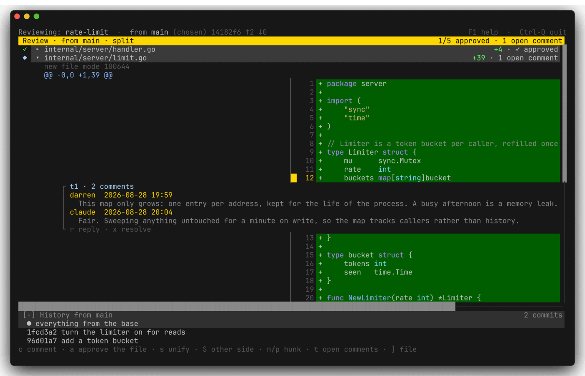
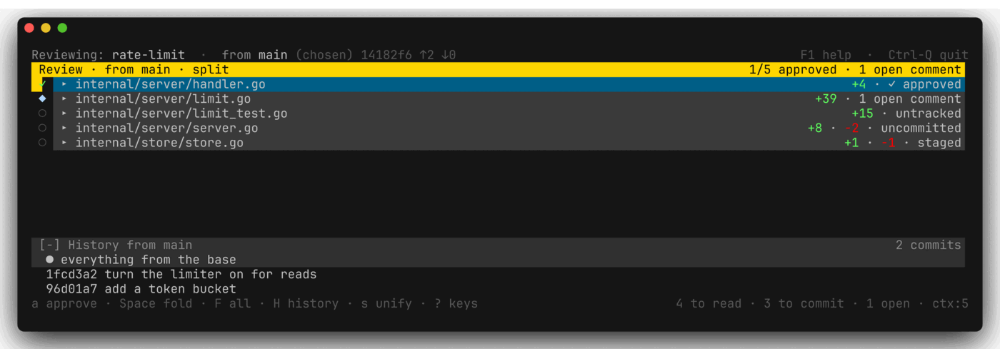
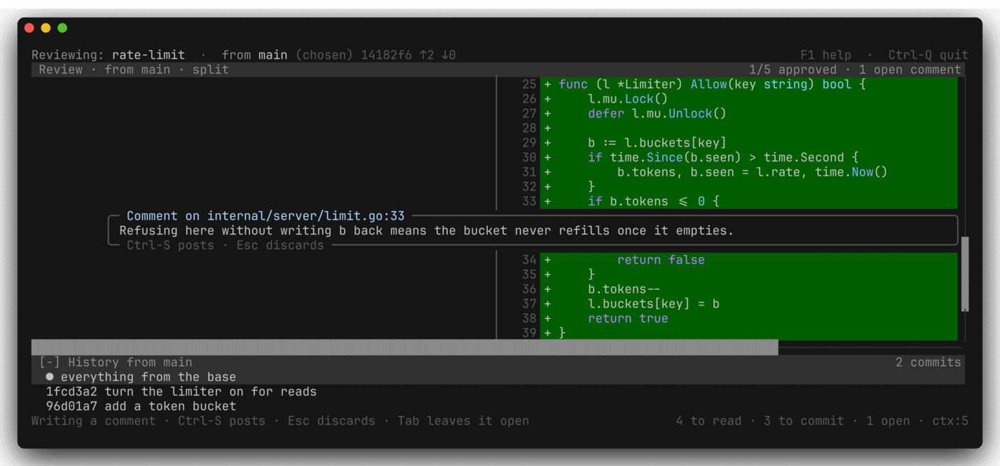
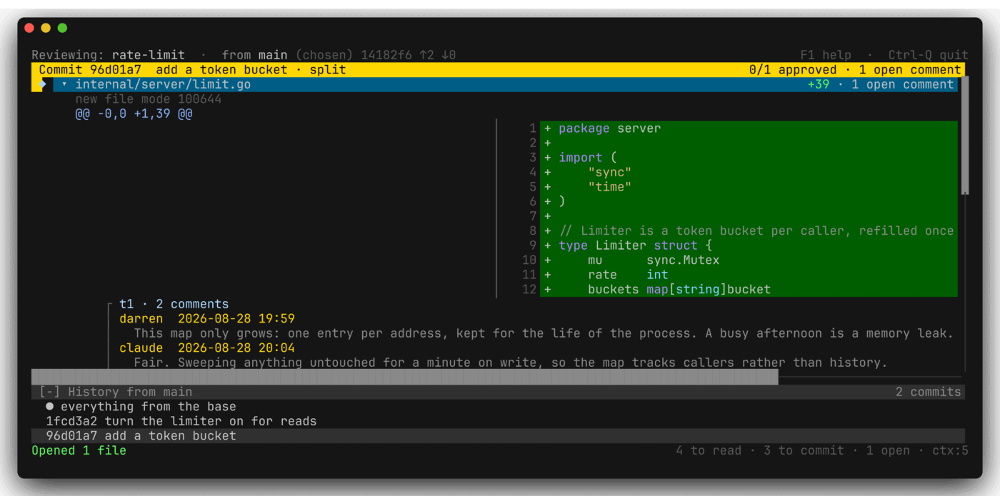
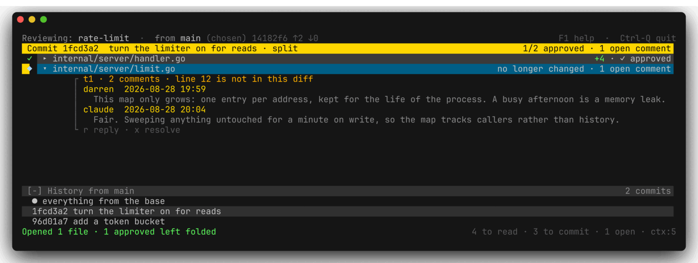
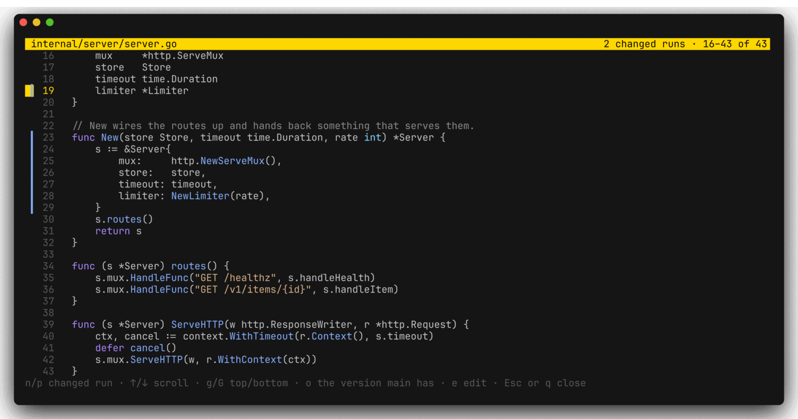
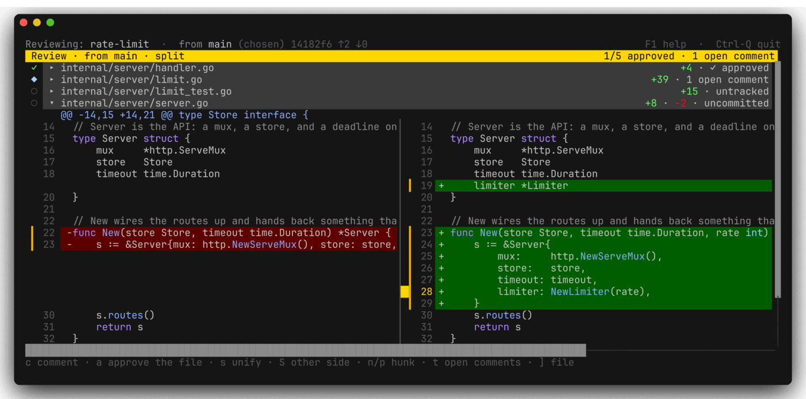

# discobox-review

A terminal **code review**. Not a diff viewer and not a commit tool: a place to
read everything a branch is proposing, approve it file by file, say what is
wrong with it line by line, and see how much of that is left — built with
[Bubble Tea v2](https://charm.land/bubbletea) and
[Lip Gloss v2](https://charm.land/lipgloss). Mouse selection comes from
[discobox-ai/x/selection](https://github.com/discobox-ai/x/tree/main/selection).



**discobox-review reads a repository and never writes one.** Nothing here stages,
commits, amends or rewrites anything. The one exception is checking out a
branch, which is choosing what to review rather than changing what is under
review.

## Install

```sh
go install github.com/discobox-ai/review/cmd/discobox-review@latest
```

The module is `review` and the command is `discobox-review`, so the path names
both. `go install` takes the binary's name from the last element of the path it
is given, which is why the command lives in `cmd/` rather than at the root.

Or from a checkout:

```sh
make build     # ./discobox-review
make install   # $GOBIN/discobox-review
```

## Run

```sh
discobox-review -by git-user                   # the repository containing the current directory
discobox-review -by git-user ~/src/foo         # a specific working tree
discobox-review -by git-user -base origin/main # measured from a ref of your choosing
```

**With nowhere to draw — output down a pipe, no terminal — it prints what it
can do without one instead of opening a window.** A full screen program writing
into a pipe would send a screenful of escape sequences nowhere and then wait
for keys that were never coming, and what is nearly always meant by running it
that way is "tell me how to use this from a script". The usage goes to stdout
and the note explaining it to stderr, so whatever asked gets the usable half on
its own. `-version` and every subcommand work the same either way.

With a subcommand it reads or writes the same review from a script instead of
opening a window — see [Driving it from a command
line](#driving-it-from-a-command-line).

```sh
discobox-review list --open
discobox-review reply t3 --by claude "fixed in the next commit"
```

## What a review is

**Everything between the merge base and the working tree.** One `git diff`
against the merge base covers it, which means the review does not care which
side of the index a change happens to be on: committed, staged and unstaged
changes are all in it, and untracked files are added on the end, since leaving
them out would mean a review that silently omitted every new file.

That is the right unit because it is what the branch is *proposing*. Reading a
branch commit by commit tells you how the author got there; reading the whole
thing tells you what you would be agreeing to. discobox-review shows the whole thing by
default and lets you drop into a single commit when you want to know how a
particular step was made.

The whole review is one buffer — every file's diff in one column, in one
scroll, the way a stacked diff reads on the web. It is one document rather than
one file at a time because that is what a review is. A pane that shows one file
with a list to go back to between each makes it hard to hold a change in your
head and easy to leave a file unread without noticing. A single stack can be
read from top to bottom, and what is left to do is how far down you have got.

**It opens folded**: every file as one row, its heading, so the first thing on
screen is the list of what changed and where each file stands. `Space` opens
the file the cursor is on and `F` opens them all. There is no separate list of
files beside the review, because the headings are that list.

### What a file's heading says

Each file's heading opens with where the file stands — `○` unread, `◆` a
comment still open, `✓` approved, `◈` approved and changed since — and then a
band carrying its name and everything standing against it: how much changed
(added in green, removed in red), what is left to commit, the verdict, and how
many comments are still waiting for an answer:

```
◆  ▾ internal/ui/model.go           +42 · −7 · uncommitted · 2 open comments
✓  ▸ internal/git/git.go                                     +30 · ✓ approved
```

The verdict stands in front of the band rather than on it, so that read down
the left edge the headings are a column of verdicts.

Those give way in a fixed order as the pane narrows — the arithmetic first,
then what is left to commit, then the verdict, and **last of all the
comments**. A count of people waiting for an answer goes to a glyph and a
number before it goes away, and a file with one will shorten its own name to
keep saying so:

```
  80 columns   ◆  ▾ model.go     +42 · −7 · uncommitted · 2 open comments
  44 columns   ◆  ▾ model.go         +42 −7 uncommitted ◆2
  24 columns   ◆  ▾ model.go                           ◆2
```

`◆2` is two comments outstanding, `✓2` two that have been answered — the same
`◆` the heading opens with, and the same `✓` a resolved thread collapses to. The verdict shortens to a bare `✓`, which is the same mark again and reads
the same way: a number after it counts remarks, and no number is the file
itself. A file whose heading is only arithmetic keeps its whole name instead:
there is nothing there worth shortening it for.

Every mark the window draws is one an ordinary monospace font has. Two that
looked better — `✔` for a verdict and `✻` for one that has fallen — turned out
to be missing from JetBrains Mono, Hack and Cascadia Mono, where they showed as
an empty box on the most important column of the screen. `✓` and `◈` are drawn
instead. (Hack has no check mark of any kind; there is nothing to be done about
that one.)

### The base

The bar at the top says what the review is measured from:

```
Reviewing: feature  ·  from origin/main 5e23e87 ↑2 ↓0
```

| Part | Meaning |
| --- | --- |
| `origin/main` | The ref the branch is measured against |
| `5e23e87` | The merge base — the commit the two last had in common |
| `↑2` | Commits on HEAD since the base |
| `↓0` | Commits on the ref since the base, in amber when there are any |

Clicking it does the same, as does clicking the branch name beside it — the
two things on that bar that name a choice are the two that offer to change it.

Press **`b`** to change it. The list offers whatever the branch tracks, the
remote's default branch, and every remote-tracking and local branch. Below
those:

| Entry | |
| --- | --- |
| `Pick a commit…` | The branch's own history, newest first — hash, when, subject |
| `Other ref…` | Anything else: a tag, `HEAD~3`, a raw hash |
| `(let discobox-review choose)` | Back to automatic |

A ref is the right answer when there is one, but the point you want to measure
from is often somewhere in your own commits — *"review what I did after this"*
— and that point has no name but its hash. Picking one makes the review
everything that commit left behind, up to the working tree:

```
 Review from a commit
   b12a29e  2 hours ago     add beta
   4944b7a  3 hours ago     capitalise two
   c71af6b  yesterday       initial
```

**The base is part of the review**, so it is written into the review file: the
next session measures from the same place, and an agent reading the file knows
what the comments are about. A base given with `-base` on the command line wins
for that session.

Left to itself, discobox-review takes:

1. **`@{upstream}`** — what `git branch -u` set.
2. **`<remote>/HEAD`** — the remote's own default branch, `origin` first.
3. **`<remote>/main`, then `<remote>/master`**.
4. **`HEAD`** — a repository with no remote at all still has a review: what has
   not been committed. Falling back rather than giving up is what stops discobox-review
   opening on an empty window.

Tracking comes first because it is what the branch was *told* to build on
rather than a guess at where it probably started, and because it is the ref the
rest of git already reports — `git status`, `git branch -vv`, and the target of
a bare `git push` all name the same one.

A ref you named that does not exist is **reported** rather than quietly
ignored: a review measured from somewhere other than where you asked is worse
than one that says it could not do as it was told.

## Approving

**`a`** signs off the file the cursor is in. **`A`** signs off every file at
once, after asking.

What is approved is **the change, not the name**. A digest of that file's whole
change from the base goes into the review with the approval, so a file edited
afterwards no longer matches and the approval falls — the file comes back
marked `◈ approval nullified` rather than `✓ approved`, which is worth telling
apart from never having been approved at all.

```
 ✓ beta.go        approved, and unchanged since
 ◈ model.go       approved once; it has moved since, so that no longer counts
 ◆ handler.go     not approved, and something is being said about it
 ○ util.go        not looked at yet
```

The digest counts **only the changed lines and their numbers**, so turning the
diff context up or down — which moves every hunk boundary — does not nullify a
single approval, while editing one character of one line nullifies exactly the
file it was in.

**Approving a file in the window folds it away again**, so what is left open
is what is left to do. `Space` on its heading opens it, and that choice sticks across rescans.
Approving hands the fold back to the rule every file starts with — folded — so
a file signed off goes away even after `F` opened everything; taking an
approval back opens the file, since that is having more to say about it.

A folded file has no gap under it, so a run of them reads as a list; an open
one ends with a blank row before the next heading.

Clicking a file's heading folds it too — anywhere along it, not only the
`▾` in front of the name. The whole thing is the disclosure control, which is
what a band across a section reads as.

It folds on the **click** rather than on the press, because the heading carries
the file's name and that is text somebody may well want to drag over and copy.
A press that stays in the cell it went down on is a click and folds; one that
moves off it is a drag and copies. Two quick clicks are two folds, so a file
you shut by mistake opens again on the next click rather than selecting the
word under the pointer.

**`F` folds every file**, turning a long review into a list of its headings,
and folds them all open again once they are shut. It is one key rather than
two because those are the same want at two moments: the map of the review is worth
reaching whether you are coming from having everything open or from having read
your way down to nothing. Anything still open decides which way it goes, so the
first press always tidies.



Opening them again **steps over the files that are done with** — approved, with
nothing outstanding said about them. "Show me everything" plainly means
everything there is still something to do about, and opening those back up
would hand back the pile the folding was clearing. So `F` hands each file to
the rule rather than forcing it open, and only the ones the rule does not fold
come back:

```
 Folded                        F                    Opened
 ○  ▸ bar.txt              ──────►    ○  ▾ bar.txt     …
 ✓  ▸ beta.go  ✓ approved             ✓  ▸ beta.go  ✓ approved   ← left alone
 ○  ▸ foo.txt                         ○  ▾ foo.txt     …
 ○  ▸ new.txt                         ○  ▾ new.txt     …
```

An approved file with an open comment on it is not done with, so it comes back
like the rest. And when *every* file is done with, the second press opens the
lot anyway — a key that looked like it did nothing would be worse than one that
occasionally shows you what you already signed off.

### Hiding what is finished

**`f`** goes further than folding: it takes the files that are done with off
the screen altogether, leaving only what is unapproved or still being argued
about.

```
 Review            1/4 approved      Review  1/4 approved · 1 hidden
 ○  ▸ bar.txt                        ○  ▸ bar.txt
 ✓  ▸ beta.go        f               ○  ▸ foo.txt
 ○  ▸ foo.txt    ──────►             ○  ▸ new.txt
 ○  ▸ new.txt
```

Folding is for while you are reading — it gets a file out of the way and leaves
it in the review. This is for the other half of the job: once most of a change
has been signed off, what is left is the list of things still wanting
something, and everything else is noise between them.

**A hidden file is finished, not gone.** The tallies still count it — `1/4
approved`, not `0/3` — because a review that appeared to shrink as it was
completed would be lying about its own size. The review's title says how many
are hidden, so a file missing from the headings is never a mystery.

`f` again brings them back.

## Comments

| Key | |
| --- | --- |
| `c` | Comment on the line under the cursor |
| `V` then `c` | Comment on a run of lines |
| `r` | Reply to the conversation under the cursor |
| `x` | Resolve it, or open it again |
| `X` | Delete a remark, or the whole conversation |
| `t` / `T` | Next / previous **open** conversation |

`c` opens a box **where the comment will land** — inline in the stack, under
the line it is about. `Ctrl-S` posts it, `Esc` throws it away. Inside the box
every letter is text, so none of the command letters are reachable until you
leave.



It is written there rather than in a field at the foot of the window because a
remark is about a particular line. Writing it somewhere else means reading the
line in one place and answering it in another, with the two never on screen
together at the size that matters — and it is the same box, in the same place,
that the comment will be read back in.

The box grows as you type and starts scrolling inside itself once it is ten
rows tall, at which point it is covering more of the diff than the remark is
worth having beside it. A reply's box goes under the conversation it answers,
and a block comment's under the last line of the block, which is where the
thread itself will be drawn.

Posting leaves the cursor on the thread that was just written, so `r` and `x`
act on it without going anywhere; `Esc` puts it back on the line.

A conversation is drawn where it was written, indented under its line:

```
 ▍  4 + FOUR
          ┌ t1 · 2 comments
          │ Darren  2026-08-28 19:59
          │   Why the shouting?
          │ claude  2026-08-28 20:04
          │   Fair. Lower-cased it.
          └ r reply · x resolve
```

**`X`** deletes what the cursor is on — one remark when it is on one, and the
whole conversation when it is on the rule above or the hint below. It asks
first, and says which of the two it is about. Taking the last remark out takes
the conversation with it: an anchor on a line with nothing to say is not a
thing to leave behind. The opening remark can go like any other, and the
replies keep their line.

Resolving is usually what you want instead — it keeps the record of what was
asked and answered. Resolving collapses it to one line, because the point of
closing a thread is to stop having to read it. `Space` opens a closed one
back up without reopening it.

```
          ✓ t1 · resolved · 2 comments · Why the shouting?
```

`V` starts a selection and `↑`/`↓` extend it, the way visual line mode does in
vim; `c` then comments on the whole block. It is anchored to the first line and
drawn under the last, where it reads as being about what came above it:

```
          ┌ t2 · 1 comment · lines 12–18
```

A selection can run over both sides of a diff at once — the lines a change took
away and the ones it put in their place — but a remark has to be anchored on
one of them, so the first line's side wins and the block covers only the lines
that share it.

### Where a comment lives

Every comment is anchored in **one** coordinate space, whichever view it was
written from:

- **`new`** — a line number in the working tree as it stands now. This is the
  common case, and it is the one an agent can act on directly: `foo.txt:412` is
  a place to go and look.
- **`old`** — a line number in the file as the base has it, for a comment on a
  line the change took away. That line does not exist in the working tree, and
  the base is the only other place it does.

There is one place a comment lives, so there is one place to look for it.

## Reading one commit

The strip under the review lists the commits the branch has made since the
base, newest first, under a row standing for the review as a whole:

```
 [-] History from origin/main    2 commits
  ● everything from the base
  000d5f8 add beta
  03a361d capitalise two
```

It is there whenever the branch has commits of its own, and takes no more
than a third of the window, its title included. **`H` folds it** down to its title and opens it
again, and so does the `[-]` / `[+]` on the title; folded, the whole title is
the button.

Pick a commit and the review pane becomes that commit's own change — against
its parent, so it reads as *what did this commit do* rather than what the
branch looks like so far. Pick the top row again and the whole review comes
back.



**Comments are not lost on the way.** They are stored against the working tree,
which is not the space a single commit's diff is drawn in, so:

- Writing one while reading a commit **carries it into the working tree's
  numbering there and then**, through the diff between that commit and the
  tree. Going back to the whole review finds it beside the same code. The
  commit it was written against is recorded alongside, as `origin`.
- Showing one while reading a commit carries it the other way, so a remark made
  against the whole review turns up beside the line in the commit that
  introduced it.
- A comment on a line the commit did not touch is **not put on the wrong line**.
  It is kept under the file's heading instead, saying why it is there.



That is also what happens to a comment whose line stops existing altogether —
the change was reverted, the base moved past it. The file keeps its place in
the stack with nothing but its remarks in it, marked `no longer changed`.
Losing a comment silently is the worst thing this window could do.

## What is not committed yet

An **amber bar down the margin** marks every line whose change is not in a
commit:

```
    2 + TWO        committed
 ▍  4 + FOUR       not committed
```

It is computed by measuring the same tree from `HEAD` instead of from the base:
whatever shows up there is what a commit has not yet swallowed. Deletions are
marked too, at the seam they left behind.

The file's heading says which kind of not-committed it is — `staged`, `uncommitted`, `part staged`,
`untracked`, `deleted`, `unmerged` — and the status bar counts them:

```
3 to read · 3 to commit · 1 open · ctx:5
```

Those are the three things a finished review has none of. When all three are
zero the bar says so:

```
clean · reviewed · ctx:5
```

**That is the state the whole window is aimed at**: every file approved, every
comment resolved, and nothing left in the margin. discobox-review will not get you
there — it does not commit — but it is unambiguous about how far off you are.

## The review file

Everything above is kept in **`.git/discobox-review.json`**.

It is a file rather than a private data structure because the other reader of a
review is increasingly an agent: something that wants to see what you objected
to, fix it, answer the thread and mark it closed, without discobox-review being
involved at all. So the format is the interface, and it is arranged around
being pleasant to read and hard to corrupt.

This is the review the pictures above were taken of, as it stands on disk:

```json
{
  "version": 1,
  "branch": "rate-limit",
  "base": "main",
  "files": [
    {
      "path": "internal/server/handler.go",
      "approved": true,
      "digest": "7cab2ca2e8394ece",
      "by": "darren",
      "at": "2026-08-28T19:41:02+01:00"
    }
  ],
  "threads": [
    {
      "id": "t1",
      "path": "internal/server/limit.go",
      "side": "new",
      "line": 12,
      "text": "\tbuckets map[string]bucket",
      "resolved": false,
      "comments": [
        { "by": "darren", "at": "2026-08-28T19:59:14+01:00", "body": "This map only grows: one entry per address, kept for the life of the process. A busy afternoon is a memory leak." },
        { "by": "claude", "at": "2026-08-28T20:04:37+01:00", "body": "Fair. Sweeping anything untouched for a minute on write, so the map tracks callers rather than history." }
      ]
    }
  ]
}
```


| Field | Meaning |
| --- | --- |
| `version` | The schema version, so a reader can tell whether it understands what it is looking at |
| `branch`, `base` | What this review is of, and what it is measured from |
| `files[].approved` | Whether the file has been signed off |
| `files[].digest` | The change that was signed off; see [Approving](#approving) |
| `files[].nullified` | The approval fell because the file moved, rather than never being given |
| `threads[].side` | `new` for a working-tree line, `old` for one the change removed |
| `threads[].line` | The line number in that space, or `0` for a comment with no line left |
| `threads[].lines` | How many lines the remark covers, counting from `line`; left out for the ordinary one-line comment, so a reader that ignores it entirely is still right about where the comment goes |
| `threads[].text` | The line as it read when the comment was written — nothing depends on it, which is the point: it is there so the file can be read on its own |
| `threads[].origin` | The commit the remark was written against, when it was not the working tree |
| `threads[].resolved` | Whether anybody still needs to do something about it |

### Driving it from a command line

The file is the interface, but hand-editing JSON is a poor way to use an
interface. Every subcommand reads the review, changes it, and writes it back —
so they are safe to interleave with a window open on the same review, which
picks the change up within the second.

```sh
discobox-review base origin/main     # what the review is measured from, saved
discobox-review diff                 # the review itself, with the line numbers below
discobox-review comment --by git-user server.go:42 "why not check the error here?"  # → t3
discobox-review comment --by claude server.go:60-74 "this block is new"
discobox-review reply t3 --by claude "good catch, fixing"
discobox-review resolve t3
discobox-review delete t3 1          # one remark of it; without the number, all of it
discobox-review approve --by git-user server.go
```

```
$ discobox-review diff
=== server.go  +3  −1  uncommitted  2 open
        @@ -1,5 +1,7 @@
    1    package main
    2
    3    func handler() error {
    4 -! 	return nil
    4 +! 	return write()    <t1>
    5    }
    6 +!
    7 +! func write() error { return nil }    <t2>

$ discobox-review list --open
t1   server.go:4              open     Darren Shepherd  why not check the error here?
t2   server.go:7              open     claude           this block is new

$ discobox-review show t1
t1  server.go:4  open
    return write()

  [0] Darren Shepherd  2026-09-03T01:15:53Z
      why not check the error here?

  [1] claude  2026-09-03T01:15:56Z
      good catch, fixing

$ discobox-review status
branch      feature
base        origin/main
merge-base  5e23e87
ahead       2
behind      0
files       4
approved    1
unapproved  3
comments    2
open        1
nullified   internal/ui/model.go
```

`status` reads the repository as well as the review, because the two things
worth knowing are not in the file. **`merge-base`** is the commit the base and
this branch last had in common — the ref can only name where to look for it —
and **`unapproved`** counts the files there are to approve, where the file
records only approvals. One fact to a line, so a script can read any of it
without reading all of it: `discobox-review status | grep ^unapproved`.

`base-chosen no` appears when nothing pinned the base, so it may move when the
branch does. `problem` appears instead of an error when the base could not be
used at all — this is the command you run to find out what is wrong, so it
answers with what it can.

**The numbers `diff` prints are the numbers `comment` takes.** That agreement
is the whole point of the command: anything that made you count lines to work
out where a remark goes would be handing back the one thing the review is
careful about. Each line carries its own side's number — the new one for a line
that is there, the old one for a line the change took away — a `!` where the
change is not in a commit yet, and `<t1>` for whatever has already been said
about it.

`--stat` prints the headings alone. `--raw` prints the plain unified diff with
none of that, which `git apply` will take.

| | |
| --- | --- |
| `diff [--path P] [--stat] [--raw]` | the review itself |
| `base [<ref>] [--auto]` | show or set what it is measured from |
| `list [--path P] [--open] [--resolved]` | list the comments |
| `show <id>` | one conversation in full |
| `comment <path>:<line>[-<line>] <body>` | start a conversation |
| `reply <id> <body>` | answer one |
| `resolve <id>…` / `reopen <id>…` | close one, or open it again |
| `delete <id> [n]` | a conversation, or one remark of it |
| `approve <path>…` / `unapprove <path>…` | sign off a file, or take it back |
| `status` | what is left to do, one fact to a line |
| `help [<command>]` | the list, or one command in full |

`base` saves, because the base is part of the review: the window and every
later command have to agree about what is under review. `--base REF` is the
other thing — one diff seen from somewhere else, changing nothing.

**`discobox-review <command> --help`** prints that one command in full: what it takes,
what it is for, the flags it accepts and a line showing it used. `discobox-review help
<command>` is the same question asked the other way. A flag belongs to the
commands that take it and is refused by the rest — a command that quietly
ignored a flag would be a command that did not do what it was told.

`--by NAME` says who a remark is from, and has no default: every remark that
goes into the review is signed by whoever asked for it. An agent passes its own
name; a person passes `--by git-user`, which takes git's own `user.name`. The
window is told the same way — it is opened `discobox-review -by git-user`, so
the comments written in it are filed under the name git already knows you by.
Nothing is guessed, because a guess would let an agent sign your name to its
own words. `--side old` anchors to the line the change
removed rather than the one it added. A place is written `path:line` or
`path:line-line`, the way a place in a review is written everywhere else.

`comment` records the line it is about along with the remark, exactly as the
window does, so a review still reads on its own away from the repository. It
reads it from the side the remark is anchored in — the working tree for `new`,
the base for `old` — which also gets it right for a line the diff never
mentions. A line that is not there gets no text rather than the wrong one.

They work on the repository containing the current directory, and on the branch
checked out there — the same branch swap the window does, so the two never
disagree about which review they are looking at.

`discobox-review approve` deliberately writes no digest, exactly as a hand-written
approval does: discobox-review stamps in the change as it stands the next time it reads
the review, which is what keeps such an approval nullifiable like any other.
`diff` and `status` do that reading, and nullify an approval whose file has
moved since — a command that reported an approval as standing when the file had
changed under it would be undoing the one thing an approval cannot do.

### Writing it from somewhere else

The smallest useful edits are all one line:

- **Answer a thread** — append to its `comments`.
- **Close one** — set `"resolved": true`.
- **Start one** — append to `threads` with a `path`, a `line`, and a `comments`
  array. `id` and `side` may be left out: ids are generated (`t1`, `t2`, …) and
  `side` defaults to `new`. Any unique id string is accepted, so an agent that
  wants to name its own may.
- **Approve a file** — add `{"path": "x.go", "approved": true}` to `files`.
  The digest may be left out; discobox-review stamps in the current one, after which
  the approval nullifies like any other. That is the point of stamping rather
  than treating a digest-less approval as stale: "approved" plainly means
  "approved as it is now".

discobox-review **notices the file changing within a second** and puts it straight on
screen. It also **re-reads the file before every write of its own**, so a
comment added a moment ago is not quietly dropped by the next approval — and it
writes the whole file through a temporary file and a rename, so a reader
polling it never catches half of one.

Between that re-read and that write it **holds a lock**, on
`discobox-review.json.lock` beside the review, and so does every command that
writes — the ones that only read included, at the moment they stamp a digest
into an approval. So any number of commands and windows can be at one review at
once and everything they write lands: thirty `comment`s started together leave
thirty comments. Nothing has to be wrapped in a lock of the caller's own.
Reading takes no lock and waits for nobody.

The lock goes with the process that took it, so one that died holds nothing,
and the lock file is simply left where it is. Nothing waits for it for ever
either: a command gives up after a minute and says the review is locked, and
the window after two seconds, with what was being written still in its box.

That covers what discobox-review writes. Something editing the JSON by hand is
outside it, and can lose a write or cause one to be lost as before; where that
matters, use the commands. Where it has to be an edit, and the system has
`flock(1)` — Linux does, macOS and Windows do not — hold the same lock around
it, briefly, since every command and window that wants to write waits while
it is held:

```sh
flock "$(git rev-parse --absolute-git-dir)/discobox-review.json.lock" ./edit-the-review
```

Do not run discobox-review itself under that lock: it would be waiting for
its own caller to let go.

A file caught halfway through being written leaves what is on screen alone and
says so in the status bar. An agent mid-save is a moment, not a reason to lose
a review.

It is polled rather than watched because polling one small file once a second
costs nothing measurable and works the same on every filesystem a repository
might be sitting on — including the network ones where a watch quietly never
fires.

### One review per branch

A review is *of a branch*, so checking out another one puts this one away:
`.git/discobox-review.json` is moved to `.git/discobox-review.<branch>.json`, and
whatever was saved for the branch you are moving to is moved into place. It is
done by moving files rather than by keying them all inside one because the live
file is then always at one path, holding one review, in the flattest shape an
agent could ask for — which is the whole reason the state is a file.

## Keys

Every command is **one letter**, and no two commands share one. A key may act
on whatever is under the cursor — `Space` folds a file in the review and
unfolds a closed comment — but that is one verb reaching
different objects, not a letter meaning two unrelated things.
`TestNoTwoCommandsShareAKey` keeps it that way.

| | | | |
| --- | --- | --- | --- |
| `a` | approve this file | `A` | approve every file |
| `Space` | fold this file | `F` | fold every file, or open them all |
| `f` | hide the files that are done with | `z` | zoom the pane |
| `H` | show the history, or hide it | | |
| `s` | unify the diff, or split it | `S` | cross a split row, to the other side |
| `c` | comment on this line | `r` | reply |
| `x` | resolve / reopen | `X` | delete the conversation |
| `b` | choose the base | `K` | check out another branch |
| `v` | read the whole file | `o` | read it as the base has it |
| `e` | edit the file in `$EDITOR` | `m` | read a markdown file, rendered |
| `V` | select a run of lines | `R` | rescan (also `F5`) |
| `-` | less diff context | `=` | more diff context |

`Space` and `Enter` are the two halves of one verb. **`Space` discloses** and
never writes anything: it folds the file you are reading — from a line two
hundred rows down as readily as from its heading, since having to scroll back
up to put a file away is an errand nobody should be sent on — and opens it
again. On a resolved conversation it opens that instead, which is the one thing
in a file's section that is not the file. **`Enter` acts**: it comments on a
line, replies to a conversation, folds a file. So reading down a diff and
pressing `Space` puts the file away, and does not start remarks you had not
asked to write; `c` or `Enter` is how a comment begins.

`Ctrl-C` or `q` quits, `F1` or `?` shows the keys.

**No letter command wears Ctrl.** The only chords bound at all are `Ctrl-C`
and `Ctrl-Q` to quit, and `Ctrl-S` to post the comment being written. The box
keeps every readline key otherwise — `Ctrl-A`, `Ctrl-E`,
`Ctrl-K`, `Ctrl-U`, `Ctrl-W`, `Ctrl-D`, `Ctrl-B`, `Ctrl-F`, `Ctrl-N`, `Ctrl-P`,
`Ctrl-T` — and plain `Enter` is a newline, because a comment is prose.

#### Why the box says Ctrl-S

`Ctrl-Enter` is bound too, and on a modern terminal it works. A terminal has
one byte for `Enter` — a carriage return — and on its own that is all
`Ctrl-Enter` produces, which inside a text field has to stay a newline. Telling
the two apart needs the terminal to be asked, so discobox-review asks: the view turns
on **key disambiguation**, the base level of the Kitty keyboard protocol, along
with `modifyOtherKeys`. Kitty, Ghostty, foot, WezTerm, recent iTerm2 and
Windows Terminal all answer.

Terminals that do not — macOS Terminal.app, plain xterm — are no worse off,
they simply go on sending a carriage return. So the box names **`Ctrl-S`**,
which arrives everywhere, and `Ctrl-Enter` and `Alt-Enter` are there for the
terminals that can say them.

Letters also need no modifier, which sidesteps macOS: Option is not Meta there
unless the terminal is configured for it, so an `Alt`-based scheme would arrive
as accented characters. The only `Alt` bindings are `Alt-1` and `Alt-2` for
jumping to a pane and `Alt-Z` for zoom — and each of those has a plain key that
does the same thing: `Tab` and `z`.

### Getting about

| Key | Action |
| --- | --- |
| `Tab`, `Shift-Tab` | Cycle focus |
| `Alt-1`, `Alt-2` | Review, history |
| `←` `↓` `↑` `→`, `h` `j` `k` `l` | Move |
| `n` / `p` | Next / previous hunk |
| `t` / `T` | Next / previous open conversation |
| `]` / `[` | Next / previous file |
| `g` / `G` | The top / the bottom |
| `24g` | Line 24 of the file the cursor is in |
| `z` | Zoom the focused pane to the whole window |
| `H` | Show the history under the review, or hide it |

The window is one column:

```
Review
──────────
History
```

There are two panes, not three: a comment being written is not one of them.
It is a box drawn into the review at the place the comment will land, so there
is nothing at the foot of the window to make room for. `Alt-2` goes to the
history, opening it if it was folded, and `↑` off its top row comes back to the
review.

**Going somewhere opens it.** A folded file has no lines on screen to land on,
so `24g` opens the file the cursor is in before it goes to the line, and `t`
and `T` open every folded file that still has a comment waiting before they
look for the next one.

A number typed in front of `g` or `G` goes to that line of the file the cursor
is in, the way `24G` does in vim — counted in the file **as it now stands**,
which is the space a comment, a stack trace or a compiler error names a line
in. Most of a file is not in its own diff, so a line that is nowhere on screen
lands on the nearest one that is and says so, rather than pretending it went
where it was asked. The status bar shows the count as you type it, and any
other key ends it.

In the review, a line running past the right margin scrolls sideways first. `→`
slides the code over by two tab stops and `←` slides it back. The line numbers and
the `+`/`-` markers stay where they are while the code moves under them, and
the pane title says which column it starts at.

A scrollbar appears down the right edge of a pane, and along the foot of the
review, only while there is something to scroll — a bar that could never move
says nothing and costs a column. The thumb is as long a share of the track as
what is on screen is of the whole, and sits at the same point along it, so it
is a rough map of the pane as well as a place marker.

**The bars are draggable.** Press the thumb and pull, and the pane follows;
press the bare track and it jumps to roughly where you pointed and then
follows. The pointer is free to wander off the bar while it is held, the way
every scrollbar works. Dragging a bar is reading ahead, so it moves the
viewport and leaves the cursor where it was — the same gesture the wheel makes.

Grabbing the thumb moves nothing until the hand moves. A track is shorter than
the thing it is a map of, so the drag is measured as a distance from where it
took hold rather than worked out afresh from where the pointer is; otherwise
merely touching the thumb would shift the pane by a row or two before you had
done anything.

The bars take their space out of the body rather than out of the pane, so the
pane keeps its width and the text gives up the room.

**A path too long for the row is cut in the middle**, not at either end:

```
◆  ▾ int…/reviewview.go          ◆2
```

Which file it is lives at the end of a path and where in the tree it sits lives
at the front, so a cut at either end throws one of those away. **The cut is
made at a slash** whenever there is room for the name it stands in front of, so
what follows the ellipsis is a whole path segment: `int…/reviewview.go` reads
as a file at the end of a path it has no room to name, where
`int…reviewview.go` reads as a name with a hole in the middle of it. Only when
the name will not fit even on its own do the two ends share what there is
between them.

#### Zoom

`z` gives the focused pane the whole window, and `z` again hands the window
back. The review zoomed has the rows the history was taking, and the history
zoomed is a log. Zooming a pane also
moves the focus to it: with one pane on screen there is nowhere else for the
keyboard to be, and a focus sitting on something invisible is how a window ends
up ignoring keys for no reason anyone can see. The zoom then follows the focus,
so `Alt-2` while zoomed hands the whole window to the history.

`Alt-Z` does the same thing from inside the comment field, where `z` is text.
Double clicking a pane's title zooms it too.

### The mouse

discobox-review takes the mouse, which means your terminal does not have it while
discobox-review is running — so it gives the gesture back rather than leaving you with
nothing.

| Gesture | What it does |
| --- | --- |
| Click a row | Focus that pane, and put the cursor on the row |
| Click the branch name | Check out another branch |
| Click the `from …` | Choose the base |
| Click a file's heading | Fold that file, or open it |
| Click `[-]` / `[+]` on the history's title | Fold the history, or open it |
| Drag a scrollbar | Scroll the pane and focus it, without moving its cursor |
| Wheel | Scroll whatever is under the pointer, and focus it |
| Wheel sideways | Slide the review across, a tab stop a tick |
| Drag | Select text, character by character |
| Double click | Select a word |
| Triple click | Select the whole line |
| `Alt`-drag | Select a rectangle |
| Release | Copy what was selected |
| Right click | Copy what is selected, and drop it |
| `Esc` | Drop it without copying |
| Double click a title | Zoom that pane |

A drag past the top or bottom edge scrolls the pane and keeps selecting, so a
selection can run well past what is on screen.

#### What you get is the content, not the furniture

Panes draw chrome down their left edge, and none of it is text anyone means to
copy. So a selection starts after it:

```
 ▍ 12 + 	return writeJSON(w, http.StatusOK, body)
└──┬──┘└──────────────────┬────────────────────────┘
   │                      └── selected: the +/- column and the code
   └── not selected: the cursor bar, the uncommitted margin, the line number
```

**Every row of the review draws the same chrome**, whether it is a line of
code, a file's heading or a comment, so one offset describes the whole pane.
Dragging down a review therefore yields the diff *and the remarks made on it*,
in the order they were read — which is a thing worth pasting somewhere. It is
also what makes a comment line up under the code it is about.

The scrollbars are chrome too: neither the one down a pane's right edge nor the
one along the review's foot is selectable, and a selection running to the right
margin stops short of the bar rather than painting over it.

A file's heading is selectable from its verdict on, so dragging over one takes
the whole path. The `+`/`-` column stays in, because a range of changed lines
copied without it is no longer a diff. When you want exact columns instead —
the code with no marker at all — `Alt`-drag takes a rectangle.

A review scrolled sideways copies what is on screen, not the lines behind it:
what you see is what you get.

Double click uses the same word characters a terminal does, so `-./?%&#:_=+@~`
count as part of a word: one double click takes a whole path, a URL, a
`host:port` or a `--flag`.

#### Copying

Copies go out as **OSC 52**, the terminal's own clipboard sequence. It travels
the same pipe the text on screen came down, so a copy lands on the clipboard of
the machine you are sitting at — over ssh, inside a container, through tmux —
rather than on whatever clipboard the host running git happens to have.

While discobox-review has the mouse, your terminal's own click-drag-to-select is gone.
Most terminals bypass mouse reporting while **Shift** is held, so Shift-drag
still gives you the terminal's selection — which is the way to select across
two panes at once, or to copy out of the comment field.

## Reading a file

A diff is what is being proposed, but sooner or later a line raises a question
the diff cannot answer — what calls this, what does the block above it do, is
that name shadowed. Leaving for an editor and coming back loses your place.

**`v`** opens the whole file, full screen, **at the line you were reading** —
with line numbers, the same syntax colours the review uses, and the lines the
review touches marked down the margin, so the change you came from is still
findable in the file you came to:



**`o`** opens the other side: the file as the base has it. Inside the reader,
`v` and `o` swap between the two **keeping the line**, so *"what did this used
to say"* is one keystroke — a line that was replaced lands on the line it
replaced, since the nth line a change added stands where the nth line it
removed used to.

`n`/`p` hop between the runs the review touched, arrows and `PgUp`/`PgDn`
scroll, `←`/`→` slide a long line across, `g`/`G` jump to either end, **`e`**
goes straight to `$EDITOR`, and `Esc`, `q`, or the key you opened it with puts
it away.

`e` opens the file the cursor is in with **`$EDITOR`**, or `vi` when that is
unset. `$EDITOR` may carry arguments of its own — `code -w`, `emacsclient -nw`
— and they are passed through. The whole terminal goes to the editor until it
exits, and discobox-review rescans when it comes back, so the review picks up whatever
you did — including nullifying an approval of what the file used to say.

While a commit is on screen the editor gets **that commit's** version, copied
to a **read-only** temporary file: history reads well in an editor, it just
cannot be written there. The copy is swept up when the editor exits.

`m` opens a markdown file in a full screen reader, rendered with
[glamour](https://github.com/charmbracelet/glamour). Arrows and `PgUp`/`PgDn`
scroll, `g`/`G` jump to either end, and `Esc`, `q` or `m` again puts it away. A
file that is not markdown (`.md`, `.markdown`, `.mdown`, `.mkd`) is refused
with a note rather than rendered as gibberish.

The text the review has changed carries a **`▍` marker** in the left margin,
and `n`/`p` hop to the next and previous marked spot. Each hop lands three
lines above the change, so a little of what came before is on screen, and the
block you hopped to is picked out in a brighter **`▌`**. The title bar counts
along: *change 2 of 5*. It is not a diff: just a "look here" in the margin of
the rendered page. Rendered lines do not map one-to-one onto source lines, so
the marker lands on whole blocks — a changed line marks its paragraph, which is
the honest granularity and the one a reader wants anyway. A deleted block has
no lines of its own to mark, so the seam it left behind is marked instead.

## Split and unified

**A review opens split**: what a line was on the left, what it became on the
right. Most changes under review are edits rather than insertions, and an edit
is far easier to read when the before and after are on the same row.



**`s`** unifies it, and splits it again. Neither is the right way round for
everything, which is why it is a key rather than a setting. A unified diff
reads as one text, and is what a patch actually is. A split one lines up what a
line *was* against what it *became*.

The review pane's title always names which one you are looking at — `split` or
`unified` — and that word is a button: clicking it does what `s` does. It is
named even when it is the ordinary one, because a mode nothing ever mentions is
a mode nobody finds. The same rule governs the branch and the base on the bar
above: the things that name a choice are the things that offer to change it.

Each run of removals is paired with the run of additions that follows it, line
for line — the same reading the [emphasis](#how-a-diff-is-drawn) makes when it
picks out the characters that changed. Runs of unequal length leave the shorter
side blank, so a pure insertion has nothing on its left. A hunk header belongs
to neither side and runs the whole width.

### Comments, in both views

Comments hang off the row that draws their line, and one written while split
lands in exactly the place one written unified would: a remark is anchored to a
file, a side and a line number, none of which are things a view can change. The
stored review does not record which way it was being read, and does not need to.

There is one thing a split row has to be told that a unified row says for
itself. A unified diff gives every line a row, so putting the cursor on a line
*is* choosing it. A split row draws two — the line the change took away and the
line it put there — and moving up and down cannot pick between them.

**`S`** crosses to the other side. The cursor bar is drawn under the half it is
in, so the line a key is about to act on is the one that looks selected, and
the title says `old side` while the cursor is on the left. Clicking a half does
the same thing with the mouse. A row with only one side — a pure insertion has
nothing on its left — draws the cursor on the side it has, whichever is live.

`s` keeps you on the line you were reading, and on the side it is numbered on,
without scrolling it: switching views is a change of how the diff is drawn, not
of where you are in it.

Both `s` and `S` end a `V` selection. A selection is a run of *rows*, and the
two views do not number rows alike — carrying one across would quietly change
which lines it covered, which is worse than dropping it and saying so.

Below 80 columns the pane — which is as wide as the window — draws a unified
diff whatever it was asked for. At the threshold each half is about thirty columns of code once the
numbers and the markers have taken theirs, and two columns of thirty are worth
having where two of twenty are not. It splits itself as soon as there is room,
and `z` zooms the review pane over the whole window, which is the other way to
find some.

Ask for it there and it says why it cannot be given, in the title, for as long
as that is true. Left alone it says nothing: a default doing the best it can
with the room it has is not a request going unmet.

## How a diff is drawn

Four things are shown at once, on channels that do not fight each other.

**The background is the diff.** An added line is a green band, a removed line a
red one, running to the right margin so changes read as solid blocks. Context
lines have no band at all.

**A stronger shade marks what actually changed.** When a run of removed lines is
followed by an equally long run of added ones, that is an edit of those lines in
order, and the characters that differ get a brighter shade of the same colour:

```
  6  -    const prefix = "hello, "         ← "hello" on a brighter red
  6 +     const prefix = "greetings, "     ← "greetings" on a brighter green
```

Anything else is a pure insertion or deletion, where there is no counterpart to
compare against and nothing to mark. It is also dropped when more than half the
line changed — at that point the whole line is the change, and marking it says
nothing.

**The foreground is the code**, syntax highlighted with
[chroma](https://github.com/alecthomas/chroma). Two details make it read well
rather than just colourful:

- Each side of a hunk is lexed as one text — context plus removed lines for the
  old side, context plus added lines for the new one. A lexer is a state
  machine, so fed one line at a time it restarts on every line and anything
  spanning lines (block comments, raw strings) is coloured as though it began
  where it did not.
- The palette is short and deliberately quiet. Keywords, types, literals and
  comments are coloured; plain identifiers and punctuation keep the default
  foreground, because colouring everything emphasises nothing. The colours also
  stay clear of the bands, so a string never lands green-on-green.

Files chroma does not recognise are shown plain, rather than run through a
fallback lexer that would colour nothing. So is a single file of more than ten
thousand diff lines, which says `plain` in its heading — highlighting is the
one part of building the stack whose cost grows with the size of the change,
so there has to be a limit somewhere, and a file that says why it has no
colours is not the same as one that quietly hasn't any.

The limit is **per file**, because you read one file at a time: a review being
large is no reason for the thirty line file in it to lose its colours. Lexing
happens off the render path, several files at a time.

**The two margins are outside the code.** The background is already carrying
the diff, so a cursor highlight drawn that way would fight it: gold marks the
cursor row and blue the rows in a `V` selection, in a one column bar at the
left edge, with the amber "not committed" bar beside it. Both columns are
always present, so rows never shift sideways.

### The gutter

A unified diff puts `+` and `-` in the same column, so an added line's code
starts immediately after its marker. discobox-review gives each side a column of its
own:

```
  context
 -removed
+ added
```

An addition always has a space between the marker and the code, so the line
reads like the file itself rather than like a patch. A deletion sits tight
against its marker instead — which costs little, since the removed side is the
one you skim.

### Line numbers and tabs

Each line is numbered on its own side — the old number for a removal, the new
one for an addition — in a column sized to the largest number in the whole
review, so it does not jitter as you read down past a file boundary.

Tabs are expanded to four columns before anything measures, tokenises or
highlights a line, so the syntax offsets, the emphasis offsets and the padding
all count the same columns. It also stops a tab rendering as an unpainted gap
in the middle of a band.

## Cost

One rescan is about a dozen git commands, whatever the size of the change: the
branch and its base, the commits it adds, the four that build the working tree
status, and **two diffs** — the review itself and the same tree measured from
`HEAD`. Both cover every file at once, so a review of two hundred files costs
the same number of commands as a review of two. Untracked files are the one
exception, since there is no revision they belong to: they cost one small
`--no-index` diff each.

Parsing and lexing that answer is the expensive part, and it is done off the
render path, so a large change never makes the window stutter. Reading a single
commit costs its own diff plus one small `-U0` diff per file, which is what
carries a comment in and out of it.

## Layout of the source

| Path | Contents |
| --- | --- |
| `cmd/discobox-review/main.go` | Flag parsing, program startup, and whether there is a terminal to draw in |
| `internal/git/system.go` | The whole system boundary: running git, and file access |
| `internal/git/system_flock.go`, `system_fcntl.go`, `system_windows.go` | The one call each kind of system spells its own way: locking a file |
| `internal/git/git.go` | Every git invocation, the scan, the base and the history |
| `internal/git/patch.go` | Unified diff parsing, splitting one diff into many files, and carrying a line number across a diff |
| `internal/review/review.go` | The review document: approvals, digests, threads, and the JSON they live in |
| `internal/review/store.go` | Reading and writing it, the lock that makes the two one step, and the branch swap — shared by the window and the commands |
| `internal/cli/cli.go` | discobox-review without the window: the subcommands |
| `internal/ui/model.go` | The Bubble Tea model: state, keys, actions |
| `internal/ui/view.go` | Where each pane goes, the bars above and below them, and what the view asks of the screen |
| `internal/ui/reviewview.go` | The stack: rows, folds, comment blocks, navigation |
| `internal/ui/keys.go` | Every binding, in one table |
| `internal/ui/diffrow.go` | One line of code, drawn |
| `internal/ui/fileview.go` | The full screen reader for a whole file, either side of the change |
| `internal/ui/scroll.go` | Drawing the bars |
| `internal/ui/scrollbar.go` | Taking hold of one and pulling it |
| `internal/ui/commitlist.go` | The history |
| `internal/ui/syntax.go` | Lexing a hunk and the syntax palette |
| `internal/ui/emphasis.go` | Tabs, and finding the characters that changed |
| `internal/ui/mdview.go` | The markdown reader |
| `internal/ui/dialog.go` | The modal layer |
| `internal/ui/theme.go` | The palette |
| `internal/ui/mouse.go` | Mouse routing, hit testing, zoom gestures and the clipboard |
| `internal/ui/grid.go` | Rendered rows read back as cells, for selecting and highlighting |
| `internal/ui/select.go` | What each pane calls content, and where on screen it starts |
| `internal/ui/util.go` | Width-aware padding and truncation |
| `internal/ui/shot_test.go` | The generator behind the pictures in this README |

### The system boundary

Everything discobox-review does outside its own process goes through one interface,
`git.System` in `internal/git/system.go`: running git, the editor, and the few
files it reads and writes directly because git has no command for them — its
own review file among them. `Local` is the implementation that runs git as a
child process and reads from the local disk, and `git.OpenWith` takes any
other.

A test walks the whole module and fails if anything outside `system.go` runs a
command or touches a file, so the boundary cannot erode by accident. Another
drives a repository entirely through a fake `System` to show the interface is
sufficient on its own. `internal/review` holds no I/O at all: loading and
saving belong to the caller, which owns the boundary.

Process I/O — `os.Stderr`, `os.Exit` in `cmd/discobox-review/main.go` — is
deliberately not behind it: it is how discobox-review talks to its own
terminal, not to a repository.

## Tests

```sh
make test
```

The tests in the root package build the program and run it, which is the only
way to ask what it does when there is no terminal. The `internal/git` tests
build throwaway repositories and exercise the real
thing: the review diff covering staged, unstaged and untracked changes at once;
the pending diff naming only what is not committed; the base following the
upstream, the remote default and a ref you named; and carrying a line number
between a commit and the working tree. `internal/review` covers the file format
an agent has to write, the digest, and what nullifies an approval. The
`internal/ui` tests drive the model with synthetic key and mouse messages and
assert on the rendered frame — including that a comment written against one
commit turns up beside the same code in the whole review, and that one whose
line has gone is kept rather than lost.

### The pictures

```sh
make screenshots
```

The screenshots in this README are taken from the running window rather than
drawn by hand. `internal/ui/shot_test.go` builds a small repository with a rate
limiter being added to it, drives the real model over it with the real keys,
and writes each frame out; [freeze](https://github.com/charmbracelet/freeze)
turns the frames into images. It is a test so that it compiles with everything
else and cannot quietly rot, and it does nothing unless `SHOTS` names somewhere
to write.

It writes the fixture's review out beside the images as
`docs/screenshots/review.json`, which is the file quoted under
[The review file](#the-review-file): the example there is a real review of a
real branch rather than one written to look like one.

A picture of a program is a claim about it, and the only way to keep the claim
true as the program moves is to take it from the program. It needs freeze,
ImageMagick, and a font holding every mark the window draws — JetBrains Mono by
default, overridable with `make screenshots SHOTFONT='Some Other Mono'`.

## License

Apache License 2.0 — see [LICENSE](LICENSE).
